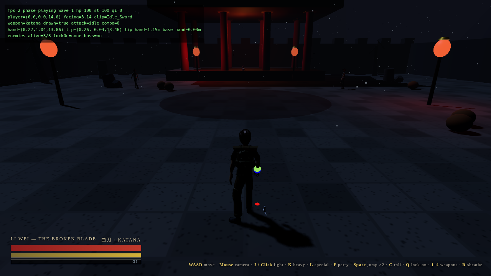
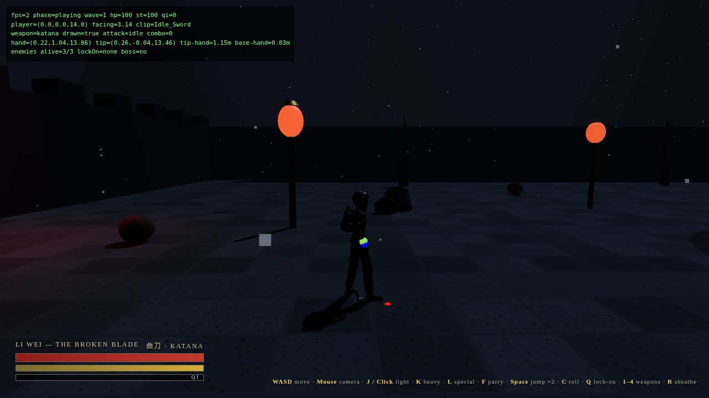
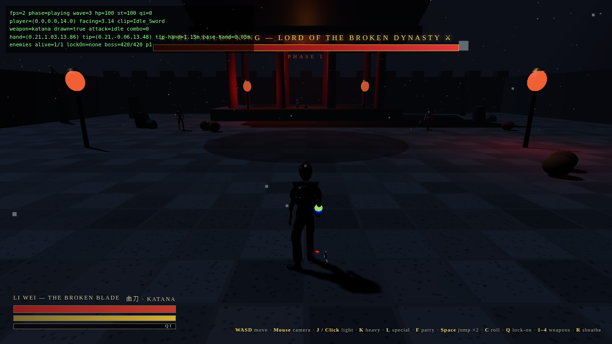

# Shadows of the Broken Dynasty

Third-person cinematic wuxia combat game — three.js + Vite + TypeScript.
Inspired by the combat philosophy of Phantom Blade Zero: fast sword combat,
perfect parries, combo chains, acrobatic movement, boss battles, in a dark
abandoned Chinese mountain fortress.

## Run

```bash
npm install
npm run dev      # http://localhost:5173
npm run build && npm run preview
```

## Screenshots





## Controls

| Input | Action |
|---|---|
| WASD | Move (camera-relative) |
| Mouse | Orbit camera (click to lock pointer) |
| Shift | Sprint |
| Space | Jump / double jump |
| J / Left click | Light attack (combo: L → L → L → Heavy) |
| K / Right click | Heavy attack |
| L | Special — Whirlwind spin |
| F / Right mouse hold | Parry (tap at the moment of impact = perfect parry) |
| Space (in air) / C | Dodge roll / dash |
| Q / Tab | Lock-on nearest enemy |
| 1 / 2 / 3 / 4 | Katana / Greatsword / Spear / Twin Daggers |
| R | Draw / sheathe weapon |
| Esc / P | Pause |

## Structure

- `src/game.ts` — orchestrator: loop, input, camera, combat, waves, boss, HUD
- `src/characters.ts` — GLB loading, rig, animation controller, procedural swing layer
- `src/weapons.ts` — weapon definitions + world-space hand/back socket follow
- `src/enemies.ts` — enemy AI state machine + boss phases
- `src/environment.ts` — fortress, temple, lanterns, rain, fog, destructibles
- `src/effects.ts` — sword trail, sparks, blood, dust, slow-mo, camera shake
- `src/audio.ts` — synthesised WebAudio SFX (whoosh, clash, parry ring, hit, footsteps)
- `DEVELOPMENT_TRACKER.md` — inspection findings, phases, test results

## Honest scope note

The supplied asset pack contains exactly **one** sword attack clip
(`Sword_Slash`, 1.0 s) per character. Combo variety is therefore built from
that clip at different rates plus a procedural torso/arm swing layer and
per-weapon speed/range/damage — not from distinct motion-captured sword clips.
See `DEVELOPMENT_TRACKER.md`.
